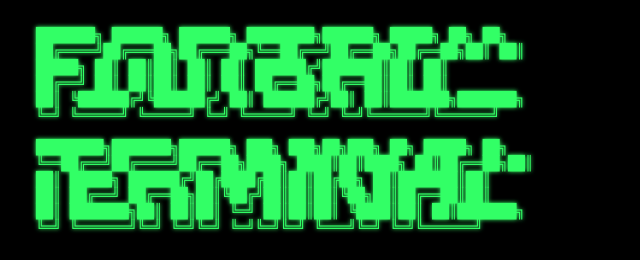
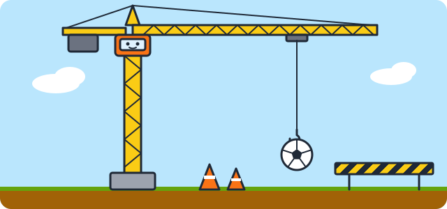

<p align="center">
  
</p>

<p align="center">
  
</p>

<p align="center">
  
  
  
  
  
  
</p>

---

> **🚧 Pitch under construction.** Football Terminal is in active development and not ready for general use yet.

## ⚽ What is it?

**One dashboard for every football stat you care about.** Search any team or league, check the table, see who's playing next, and dive deep into player profiles, statistics and analysis — all in one fast, clean interface. Powered by data from [API Football](https://www.api-football.com/).

## 🧰 Tech stack

```text
backend   ▸ Java 21 · Spring Boot 4 · RestClient · Caffeine cache
frontend  ▸ React 19 · TypeScript 5 · React Router 7 · Vite 7
data      ▸ API-Sports v3 (https://v3.football.api-sports.io)
```

<p align="center">
  
</p>
